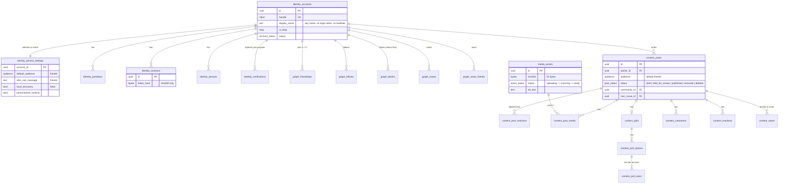
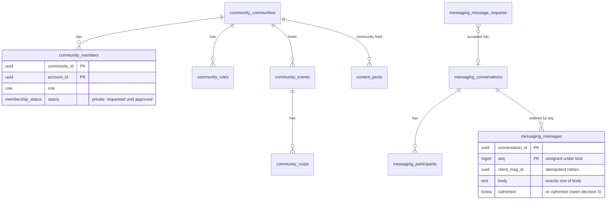
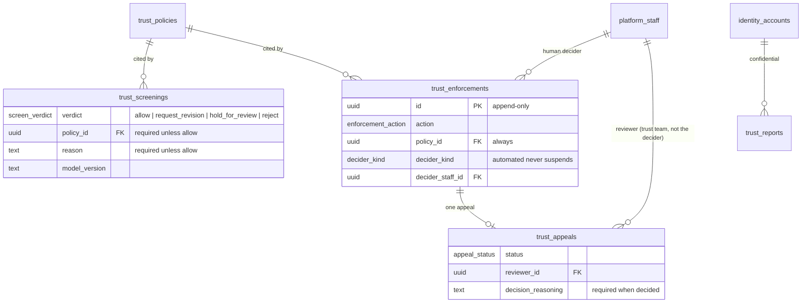
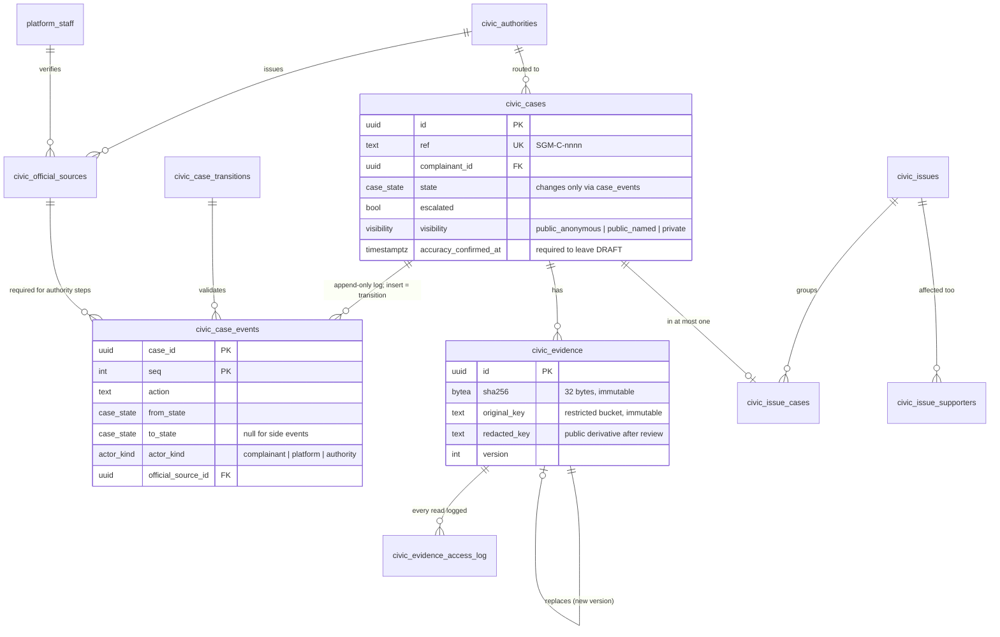
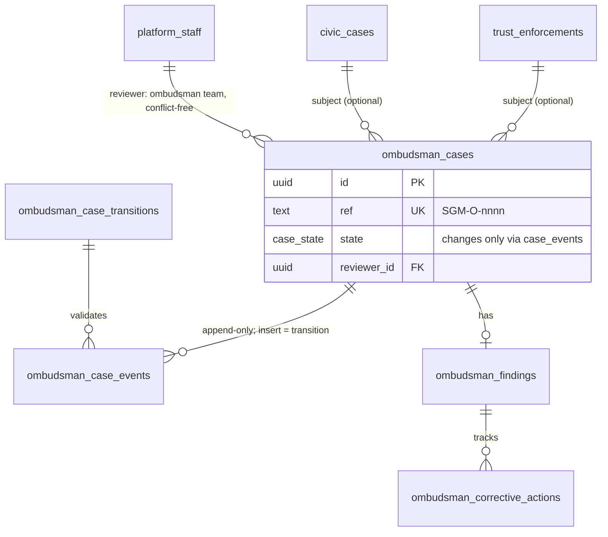

# Sangam data model (ERD)

PostgreSQL 16, one schema per bounded context. The executable source is [`db/migrations`](../db/migrations); these diagrams show its tables and keys. Columns are trimmed to keys and the fields that carry a rule.

## Identity, graph and content

`content.can_view(viewer, post)` is the single visibility check (audience, close friends, blocks in either direction, draft and held posts visible only to the author). Feeds, search, shares and community views all call it at serve time.

## Communities and messaging

## Trust and safety

## Sangam Civic

The state machine is [`state-machines/civic.json`](../state-machines/civic.json). `civic.public_case_summaries` never exposes private cases or anonymous complainants. `civic.category_stats_90d` counts an acknowledgement only when an authority event cites a verified source.

## Ombudsman

`ombudsman.is_conflicted(reviewer, case)` rejects anyone outside the Ombudsman team, and anyone who decided the subject enforcement or its appeal.

## Platform

`platform.outbox` (transactional outbox; payloads follow [`events/`](../events)), `platform.idempotency_keys`, `platform.notifications`, `platform.staff`.
